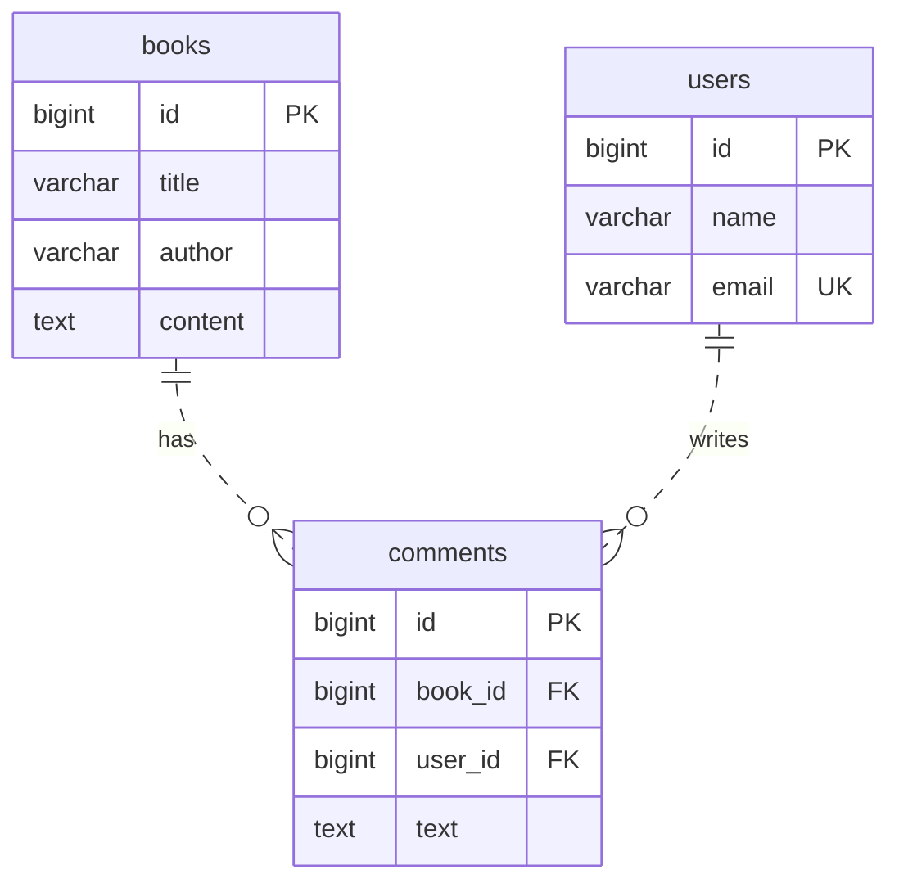

# Mini Reader

## 1. Project Overview

Mini Reader is a small full-stack application for reading a book and discussing it through comments. The React interface displays the book's title, author, and text alongside the discussion. A Laravel JSON API serves the book and its comments and persists changes in PostgreSQL.

## 2. Features

- Read the seeded book and view its title, author, and text.
- View comments and the name of each comment's author.
- Add and delete comments from the reading page.
- Validate comment text on the server. The `text` field is required, must be a string, and is limited to 1,000 characters. The frontend also blocks blank submissions and limits the textarea to 1,000 characters.
- Store users, books, and comments in PostgreSQL with the documented local configuration.

## 3. Tech Stack

| Layer | Technology | Version or requirement |
| --- | --- | --- |
| Frontend | React and React DOM, TypeScript | React and React DOM 19.3.1, TypeScript 7.0.2 |
| Frontend tooling | Vite, Tailwind CSS | Vite 8.3.8, Tailwind CSS 4.3.5 |
| Backend | PHP, Laravel, Eloquent ORM | PHP `^8.3` in `backend/composer.json`, with PHP 8.4.1 or later required by the lock file. Laravel 13.44.1 includes Eloquent. |
| Backend dependency | Laravel Sanctum | 4.5.0 |
| Database | PostgreSQL | 16 (`postgres:16` in `compose.yaml`) |
| Infrastructure | Docker Compose | Uses `docker compose`. The repository specifies no exact CLI version. |

Package versions come from `frontend/package-lock.json` and `backend/composer.lock`.

## 4. Project Structure

```text
mini-reader/
├── compose.yaml               # PostgreSQL service and named volume
├── frontend/
│   ├── src/
│   │   ├── api/               # Fetch client for books and comments
│   │   ├── types/             # TypeScript types for API data
│   │   ├── App.tsx            # Reader, comment form, and discussion
│   │   ├── index.css          # Tailwind CSS entry point
│   │   └── main.tsx           # React entry point
│   └── vite.config.ts         # Frontend plugins and development API proxy
└── backend/
    ├── app/
    │   ├── Http/
    │   │   ├── Controllers/   # Book and comment API handlers
    │   │   └── Requests/      # Comment creation validation
    │   └── Models/            # Eloquent models and relationships
    ├── bootstrap/            # Route registration and exception configuration
    ├── config/               # Laravel application and service configuration
    ├── database/
    │   ├── migrations/       # Schema definitions
    │   └── seeders/          # Initial book and test reader
    ├── public/               # Laravel web entry point
    ├── routes/               # API, web, and console routes
    └── tests/                # Laravel test suite
```

## 5. Architecture

- **Request flow.** React sends JSON API requests to relative `/api` URLs. During local development, Vite forwards those requests to Laravel at `http://localhost:8000`. Laravel uses Eloquent to query and update PostgreSQL through the host port `5434`.
- **Routes and controllers.** `backend/bootstrap/app.php` registers `backend/routes/api.php` under `/api` and configures JSON exception responses for API requests. `BookController` handles book retrieval. `CommentController` handles creation and deletion. `StoreCommentRequest` validates the creation payload before the controller runs.
- **Route model binding.** Laravel resolves `{book}` and `{comment}` to `Book` and `Comment` instances by primary key. A missing record returns `404 Not Found`.
- **Relationships and eager loading.** `Book::comments()` defines a one-to-many relationship. `Comment::book()` and `Comment::user()` identify the parent book and author. The book controller eager-loads `comments.user` before serializing the book. The creation endpoint loads the new comment's `user` before returning it.
- **Frontend API client.** `frontend/src/api/books.ts` exposes typed `getBook`, `createComment`, and `deleteComment` functions over a shared Fetch wrapper. The wrapper requests JSON, reports unsuccessful HTTP statuses, and handles an empty `204` response. After a successful write, React appends or removes the comment in its local state.

## 6. Database Schema

| Table | Main fields |
| --- | --- |
| `users` | `id` (primary key), `name`, unique `email`, nullable `email_verified_at`, hashed `password`, nullable `remember_token`, `created_at`, `updated_at` |
| `books` | `id` (primary key), `title`, `author`, `content` (text), `created_at`, `updated_at` |
| `comments` | `id` (primary key), `book_id` (foreign key), `user_id` (foreign key), `text`, `created_at`, `updated_at` |

Every comment belongs to one book and one user. A book or user can have zero or more comments. Both foreign keys cascade on delete, so deleting a book or user also deletes its associated comments.



## 7. API Endpoints

| Method | Route | Purpose | Response statuses |
| --- | --- | --- | --- |
| `GET` | `/api/books/{book}` | Return a book and its comments with author records. | `200 OK`, `404 Not Found` if the book is missing |
| `POST` | `/api/books/{book}/comments` | Create a comment as the seeded test reader and return it with its author. | `201 Created`, `404 Not Found` if the book or test reader is missing, `422 Unprocessable Content` if validation fails |
| `DELETE` | `/api/comments/{comment}` | Delete a comment by ID. | `204 No Content`, `404 Not Found` if the comment is missing |

Laravel also registers `HEAD /api/books/{book}` with the same status as `GET` and an empty body.

The following PowerShell examples call Laravel directly. They assume a freshly seeded database with book ID `1`.

### Fetch the book

```powershell
$api = 'http://localhost:8000/api'
Invoke-RestMethod -Method Get -Uri "$api/books/1" -Headers @{ Accept = 'application/json' }
```

Example `200 OK` response before any comments have been added. Timestamp values are illustrative.

```json
{
  "id": 1,
  "title": "Crime and Punishment",
  "author": "Fyodor Dostoevsky",
  "content": "Example book content.",
  "created_at": "2026-11-25T10:00:00.000000Z",
  "updated_at": "2026-11-25T10:00:00.000000Z",
  "comments": []
}
```

When comments exist, each entry in `comments` has the same structure as the creation response below.

### Create a comment

```powershell
$body = @{ text = 'What does the opening tell us about the narrator?' } | ConvertTo-Json
$comment = Invoke-RestMethod -Method Post -Uri "$api/books/1/comments" `
    -Headers @{ Accept = 'application/json' } -ContentType 'application/json' -Body $body
$comment | ConvertTo-Json -Depth 4
```

Example `201 Created` response. IDs and timestamps depend on the database.

```json
{
  "id": 1,
  "book_id": 1,
  "user_id": 1,
  "text": "What does the opening tell us about the narrator?",
  "created_at": "2026-11-25T10:01:00.000000Z",
  "updated_at": "2026-11-25T10:01:00.000000Z",
  "user": {
    "id": 1,
    "name": "Test Reader",
    "email": "reader@example.com",
    "email_verified_at": null,
    "created_at": "2026-11-25T10:00:00.000000Z",
    "updated_at": "2026-11-25T10:00:00.000000Z"
  }
}
```

A request body of `{}` returns `422` with a validation message and field errors under `errors.text`.

### Delete the comment

```powershell
Invoke-WebRequest -Method Delete -Uri "$api/comments/$($comment.id)" `
    -Headers @{ Accept = 'application/json' } -UseBasicParsing |
    Select-Object StatusCode
```

Successful deletion returns `204 No Content` with an empty body.

## 8. Getting Started

### Prerequisites

- Git and Windows PowerShell or PowerShell 7.
- PHP 8.4.1 or later in the PHP 8 series, with `pdo_pgsql` enabled for PostgreSQL, and Composer 2. The minimum PHP patch release follows the locked backend dependencies.
- Node.js `^20.19.0` or `>=22.12.0` and npm, as required by the locked frontend tooling. Use `npm.cmd` in PowerShell to invoke the Windows command shim.
- Docker with Compose and a running Docker engine. On Windows, start Docker Desktop in Linux container mode.

### 1. Clone the repository

```powershell
git clone https://github.com/gordienkodev/mini-reader.git
Set-Location mini-reader
```

### 2. Start PostgreSQL

Run these commands from the repository root. Wait for `pg_isready` to report that the server is accepting connections before running migrations.

```powershell
docker compose up -d postgres
docker compose exec -T postgres pg_isready -h 127.0.0.1 -p 5432 -U reader -d reader
```

Compose maps container port `5432` to `127.0.0.1:5434` on the host. The `postgres_data` volume persists the database across container restarts.

### 3. Install backend dependencies

```powershell
Set-Location backend
composer install
```

### 4. Configure the backend environment

From `backend/`, copy the environment template on a fresh checkout.

```powershell
Copy-Item .env.example .env
```

In `backend/.env`, replace the default SQLite configuration with these values. Replace `<local-postgres-password>` with the value of `POSTGRES_PASSWORD` for the `postgres` service in the root `compose.yaml`.

```dotenv
DB_CONNECTION=pgsql
DB_HOST=127.0.0.1
DB_PORT=5434
DB_DATABASE=reader
DB_USERNAME=reader
DB_PASSWORD=<local-postgres-password>
```

### 5. Generate the application key

```powershell
php artisan key:generate
```

### 6. Run migrations and seeders

```powershell
php artisan migrate --seed
```

This creates the database tables and seeds *Crime and Punishment* and the `Test Reader` account. On a fresh database the book receives ID `1`, which the frontend requests on startup.

### 7. Start Laravel

Keep this PowerShell session open.

```powershell
php artisan serve --host=localhost --port=8000
```

### 8. Install frontend dependencies and start Vite

Open a second PowerShell session at the repository root.

```powershell
Set-Location frontend
npm.cmd ci
npm.cmd run dev
```

| Service | Address |
| --- | --- |
| React reader | [http://localhost:5173](http://localhost:5173) (Vite's default port, see its terminal output if the port is busy) |
| Laravel | [http://localhost:8000](http://localhost:8000) |
| Book API | [http://localhost:8000/api/books/1](http://localhost:8000/api/books/1) |
| PostgreSQL from the host | `127.0.0.1:5434` |

## 9. Technical Decisions

- **Eloquent ORM** maps database records to Laravel models. Creating a comment through `$book->comments()->create(...)` associates it with the route-bound book.
- **Form Request validation** puts the payload rules in `StoreCommentRequest` and gives the controller validated input through `$request->validated()`.
- **Eager loading** fetches the comments and their authors in batches. Laravel can serialize all author data without issuing a separate author query for each comment, avoiding the N+1 query pattern.
- **REST API client** centralizes Fetch and response handling in one frontend module. Relative URLs let the browser send same-origin requests to Vite during development.
- **Migrations and seeders** make the schema and initial data reproducible. The seeders use `firstOrCreate` for the test reader and sample book so rerunning them can reuse those records.

## 10. Current Limitations

- The frontend loads book ID `1` directly. The interface has no book catalog or selector, and the seeded book contains placeholder text.
- All new comments are attributed to the seeded `Test Reader` account (`reader@example.com`). Comment creation depends on that account being present.
- Sanctum is installed, but the application has no sign-in flow and the API routes have no authentication middleware. The creation Form Request permits all callers.
- The delete endpoint has no ownership or permission check. Any caller who can reach the API and knows a comment ID can delete it.
- The API serializes the related user model, including the author's email address. The frontend displays the author's name.
- The `/api` proxy is configured in Vite's development server. Serving a built frontend requires routing `/api` to Laravel in the hosting setup.
